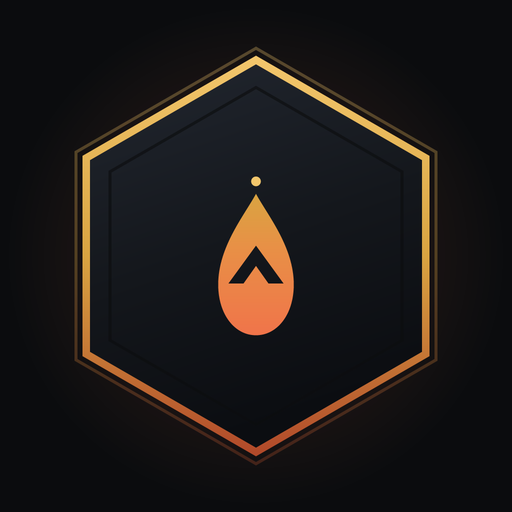
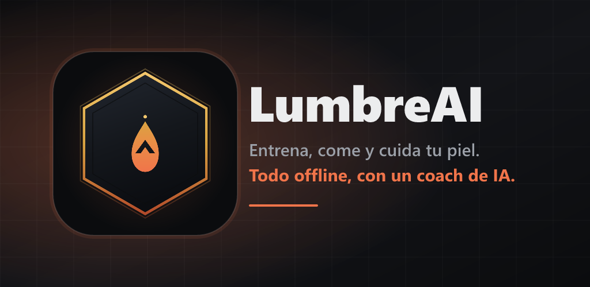
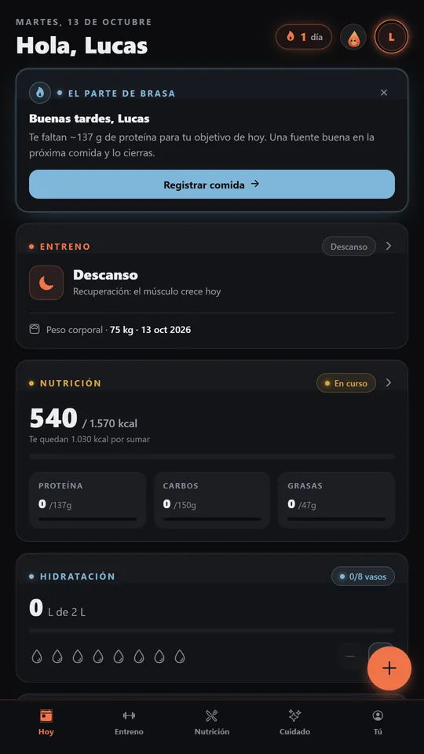
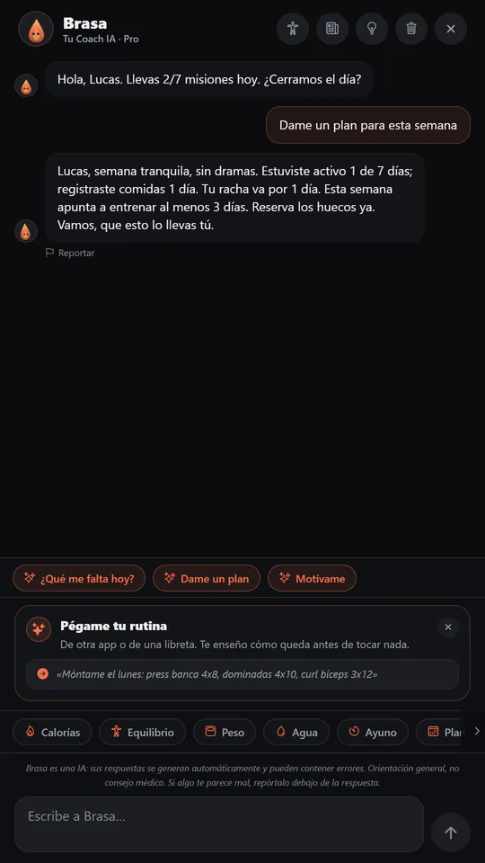
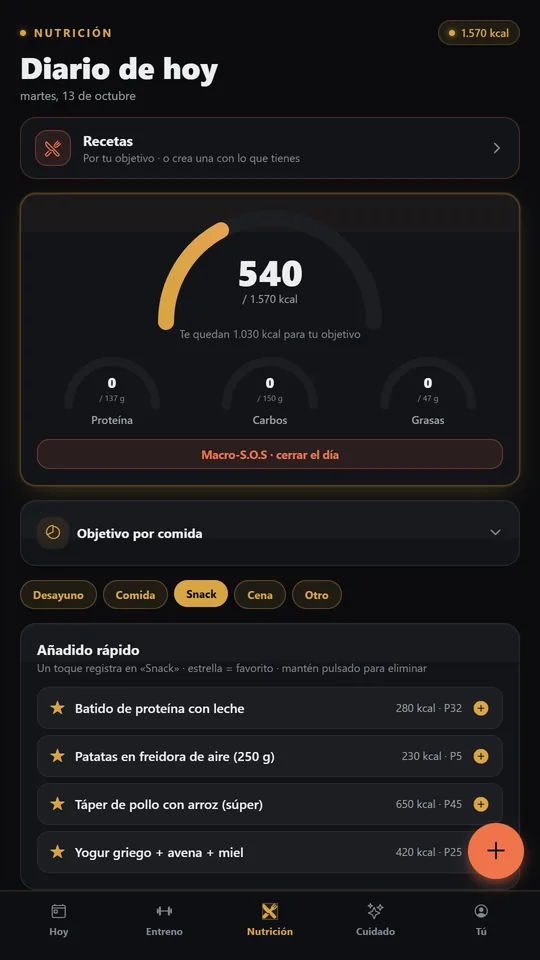
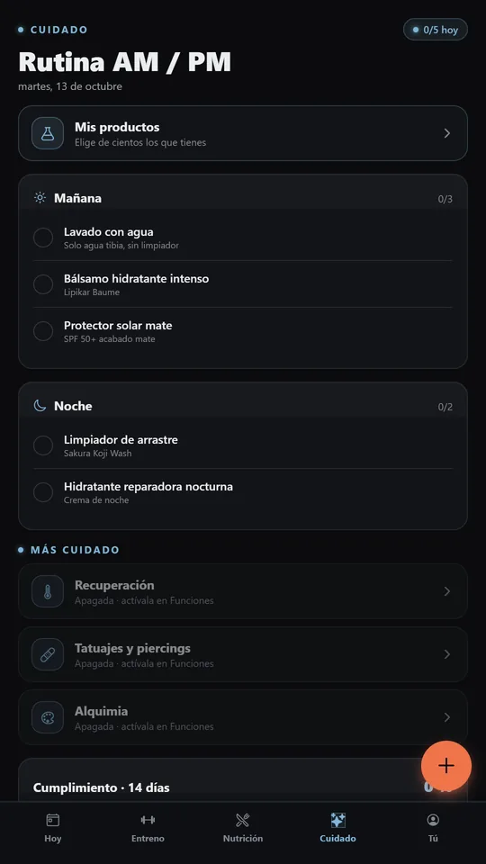
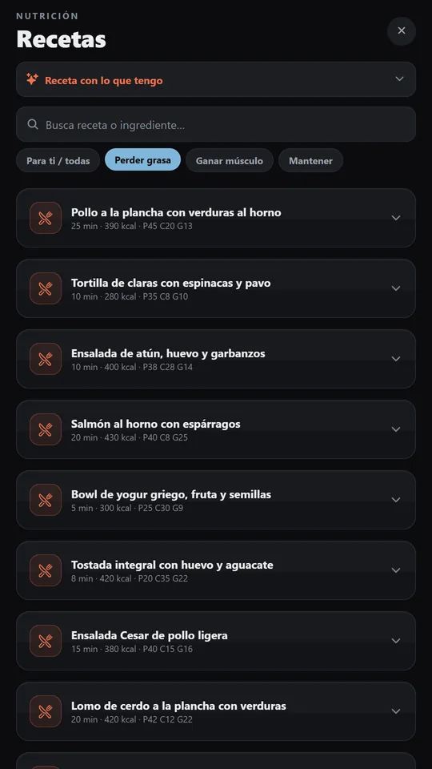
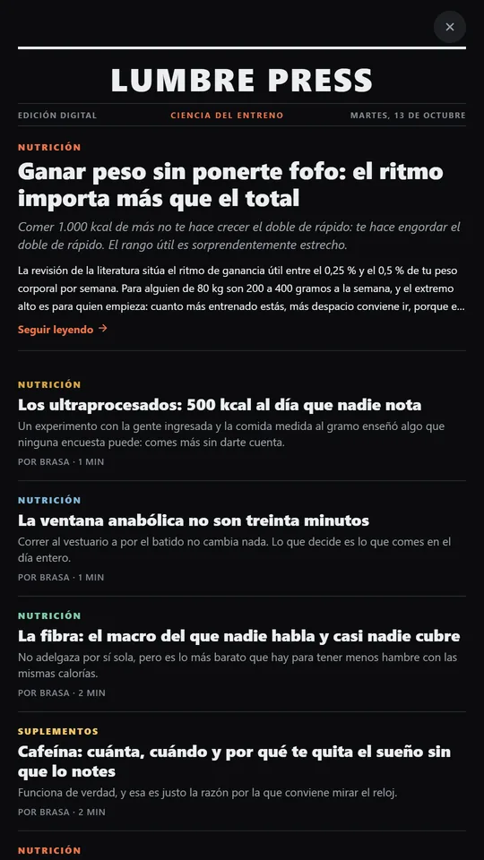

# LumbreAI

**Entrena, come y cuida tu piel. Todo offline y con un coach de IA.**

<a href="https://lucasusamentiaga.github.io/descargar/"><b>Descargar para Android</b></a> ·
<a href="#hazte-tester">Hazte tester en Google Play</a> ·
<a href="#english">English</a>

  

---

## Cuatro apps, una sola lumbre

| | |
|---|---|
| 🔥 **Entrena** | Rutinas, series y peso. Calcula tu 1RM, guarda tus récords y te dice si progresas de verdad. Rangos por fuerza relativa, de Pirita a Painita. |
| 🍽️ **Come** | Haz una foto del plato y te dice calorías y macros. Lee códigos de barras, filtra 400+ recetas por tu objetivo y cierra el día diciéndote qué te falta. |
| 💧 **Cuídate** | Rutina de piel de mañana y noche, hábitos, ánimo, sueño, ayuno intermitente y respiración. |
| 💬 **Pregunta** | **Brasa**, un coach de IA que sabe cuánto llevas entrenando y qué te queda hoy, y te contesta citando tus datos. |

Y una mascota, **Lumbre**, que crece con tu racha.

## Así se ve

 

## Por qué es distinta

- **Funciona sin conexión.** Tus entrenos, comidas, medidas y fotos viven en tu móvil. Sirve en un gimnasio sin cobertura.
- **Sin cuenta para empezar.** Solo hace falta una si usas las funciones sociales.
- **Tus datos, tuyos.** Puedes exportarlos, llevarlos a otro móvil y borrar tu cuenta desde Ajustes. [Política de privacidad](https://lucasusamentiaga.github.io/lumbreai-legal/privacidad.html).
- **Accesible.** Botones con nombre para lectores de pantalla, contraste AA y respeto por el tamaño de letra y el «reducir movimiento» del móvil.

## Hazte tester

LumbreAI está en prueba cerrada en Google Play y necesita testers para salir para todo el mundo:

1. Únete al grupo [testers-community](https://groups.google.com/g/testers-community) con el Gmail de tu móvil.
2. Abre [el enlace de la prueba](https://play.google.com/apps/testing/com.lukit.lumbreai) y pulsa «Convertirse en tester».
3. Instálala desde Google Play y ábrela de vez en cuando durante 14 días.

¿Prefieres no esperar? [Descárgala directamente](https://lucasusamentiaga.github.io/descargar/).

## Cómo está hecha

`React Native` · `Expo` · `TypeScript` · `SQLite` · `Supabase` · `NativeWind`

App *offline-first* con base de datos local, servidor solo para lo que lo necesita (IA, amigos, copias) y más de 1.500 pruebas automáticas. Desarrollada por [Lucas Usamentiaga](https://github.com/lucasusamentiaga) con ayuda de IA.

> **Este repositorio es un escaparate.** El código fuente es privado y todos los derechos están reservados (ver [LICENSE](LICENSE)).

LumbreAI no es un servicio médico ni sustituye a un profesional.

---

## English

**Train, eat and care for your skin. Fully offline, with an AI coach.**

LumbreAI brings your workouts, meals, skincare and habits into one app that works without a connection, plus **Brasa**, an AI coach that knows your numbers. Spanish and English.

- **[Download for Android](https://lucasusamentiaga.github.io/descargar/)** (Android 7 or later)
- **Become a tester on Google Play:** join [testers-community](https://groups.google.com/g/testers-community), open [the test link](https://play.google.com/apps/testing/com.lukit.lumbreai), tap “Become a tester” and install it from Play.

This repository is a showcase: the source code is private and all rights are reserved. LumbreAI is not a medical service.
